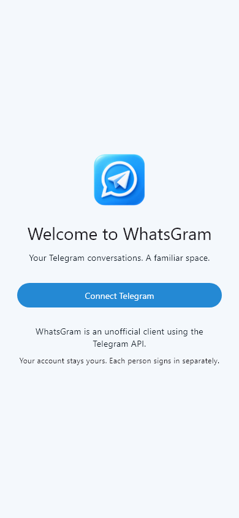
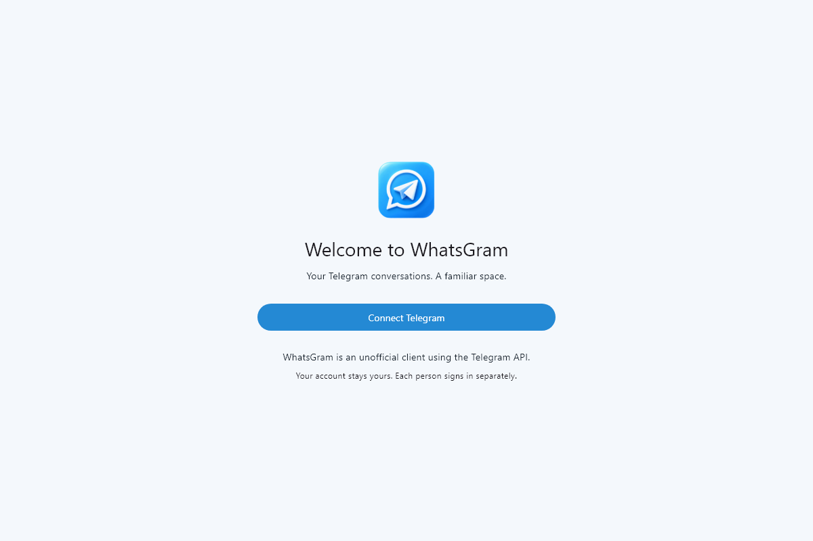

# WhatsGram

WhatsGram is an unofficial client using the Telegram API. A single Flutter project targets **Android and Windows**, with Telegram-blue conversation layouts and a shared chat-selection workspace for two independently authenticated Telegram accounts.

Messages and media stay in their original Telegram conversations. A dedicated private Telegram settings supergroup carries validated selection events. No hosted application backend, Supabase, Firebase, GitHub chat database or pet implementation is included.

## Run locally

1. Install Flutter 3.47.6 and the target platform toolchain.
2. Copy `config/telegram.example.json` to ignored `config/telegram.local.json`, then add your own Telegram API ID/hash.
3. Build the pinned TDLib 1.8.67 native library for the target.
4. Run `flutter pub get`, `flutter analyze`, and `flutter test`.
5. Run `./scripts/run.ps1 windows` or `./scripts/run.ps1 android`.

The original workspace is available through `C:\Projects\WhatsGram`; its SDK is at `C:\Projects\WhatsGramFlutter`. Clone elsewhere into a short writable path if preferred.

## Implementation

- A real TDLib JSON FFI transport in a dedicated isolate, with ordered updates, request correlation, timeouts, shutdown and native-version validation.
- TDLib-driven phone, code, two-step password, email and QR authorization; session encryption keys in platform secure storage.
- Verified two-account workspace pairing, versioned settings events, durable offline selection changes, deterministic Lamport conflict resolution and history replay.
- Selected participant-pair conversations, shared supergroups and real forum topics; group-wide selection includes its topics.
- Paginated/live text messaging, replies, edit/delete/forward/reactions, selected-scope search, active-view read handling and per-device mute/pin preferences.
- Photo/original-document/video attachments, native M4A voice recording, playback, transfer controls and safe exports; automatic export is off by default.
- Responsive desktop/narrow layouts, light/dark/system themes, native local notifications, supplied branding and native icons.

The presence of implementation code does not establish a passed live-account acceptance test. **Read [VERIFICATION.md](docs/VERIFICATION.md) for the actual build/test results and remaining limitations.** This repository must not be advertised as a fully accepted production client until the two-account checklist passes on both devices.

## Interface previews

These are renders of the actual welcome screen, before Telegram sign-in.

## Documentation

- [Phone and Windows usage guide](docs/DEVICE_GUIDE.md)
- [Setup and credentials](docs/SETUP.md)
- [Windows native build and complete release bundle](docs/BUILD_WINDOWS.md)
- [Android native build and release signing](docs/BUILD_ANDROID.md)
- [Pairing and selection](docs/PAIRING.md)
- [Architecture and future pet boundary](docs/ARCHITECTURE.md)
- [Privacy and storage](docs/PRIVACY.md)
- [Tests and two-account acceptance checklist](docs/TESTING.md)

Official references: [TDLib](https://core.telegram.org/tdlib), [getting started](https://core.telegram.org/tdlib/getting-started), [API documentation](https://core.telegram.org/tdlib/docs/), [Telegram API terms](https://core.telegram.org/api/terms), [Flutter Windows builds](https://docs.flutter.dev/platform-integration/windows/building).
